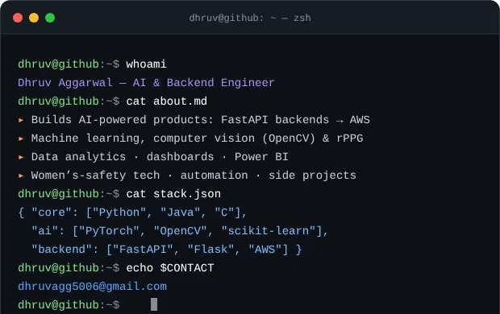

## 🚀 About Me

## 🛠️ Skills & Technologies

### 🧑‍💻 Languages

### 🤖 Data Science & ML

### 📊 Data Analytics & BI

### 🏗️ Data Engineering

### ⚙️ Backend & Databases

### ☁️ Cloud & Tools

### 📈 Skill Progress

## 🚀 Featured Projects

| Project | What it does | Stack |
|---|---|---|
| [**She-ield**](https://github.com/Aayansh-singh-24/She-ield) | Women's safety platform: SOS, live location, AI distress detection | FastAPI · React · ML |
| [**StaySmart**](https://github.com/Dhruvagg5006/StaySmart) | AI-powered Airbnb-style rental system | TypeScript |
| [**HealLens**](https://github.com/Dhruvagg5006/HealLens) | Estimates vitals (SpO₂, BP) from video using rPPG | Python · OpenCV |
| [**Credit-Card-Fraud-Detection**](https://github.com/Dhruvagg5006/Credit-Card-Fraud-Detection) | ML model to flag fraudulent transactions | scikit-learn |
| [**Smart_Expense_Tracker**](https://github.com/Dhruvagg5006/Smart_Expense_Tracker) | Expense tracking & analysis | Pandas |

## 📈 Activity

Every stat on this page is regenerated automatically by GitHub Actions.

 

## 🌐 Connect With Me

 

