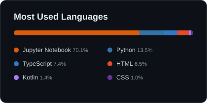
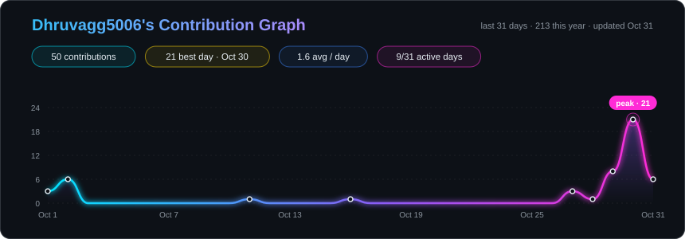
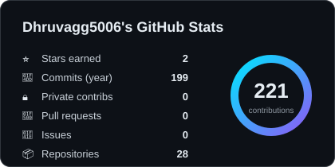
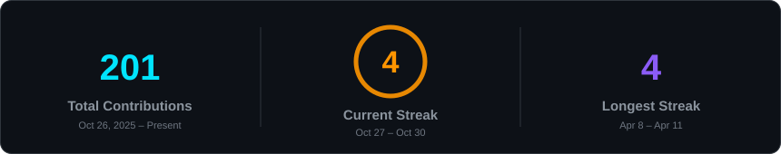

 

<!-- &nbsp;
&nbsp;
 -->

## 🚀 About Me

## 🛠️ Skills & Technologies

### 🧑‍💻 Languages

### 🤖 AI / ML / Data

### ⚙️ Backend

### 🗄️ Databases

### ☁️ Cloud, Deployment & Tools

### ✨ Daily Drivers

## 🚀 Featured Projects

| Project | What it does | Stack |
|---|---|---|
| [**She-ield**](https://github.com/Aayansh-singh-24/She-ield) | Women's safety platform: instant SOS alerts, live location, secure audio recording, AI distress detection | FastAPI · React · ML |
| [**StaySmart**](https://github.com/Dhruvagg5006/StaySmart) | AI-powered Airbnb-style rental system | TypeScript |
| [**HealLens**](https://github.com/Dhruvagg5006/HealLens) | Estimates vitals (SpO₂, BP) from video using rPPG | Python · OpenCV |
| [**Credit-Card-Fraud-Detection**](https://github.com/Dhruvagg5006/Credit-Card-Fraud-Detection) | ML model to flag fraudulent transactions | Jupyter · scikit-learn |
| [**Smart_Expense_Tracker**](https://github.com/Dhruvagg5006/Smart_Expense_Tracker) | Expense tracking & analysis | Jupyter · Pandas |

## 📈 Activity

 

## 🌐 Connect With Me

&nbsp;&nbsp;

  

